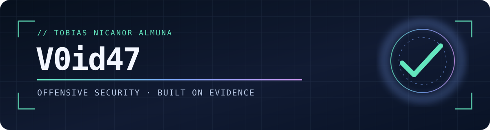

### Hi, I'm Tobias Nicanor Almuna 👋

**Offensive security practitioner in training · Pentesting · Red team path**

Based in Buenos Aires, Argentina · English / Español

---

## About me

I build security tools and document hands-on research with a focus on **clear evidence, reproducible methods, and responsible scope**. My current work spans web and HTTP security, authentication log analysis, CTF challenges, and technical write-ups. I'm developing toward professional penetration testing and red team work.

> **Approach:** define scope → collect evidence → reproduce findings → explain impact and limitations → recommend a fix.

## Selected work

| Project | What it shows |
| :--- | :--- |
| [**SentinelHTTP**](https://github.com/V0id47/sentinelhttp) · Go | A bounded HTTP/HTTPS security configuration assessment tool with scope controls, evidence-backed findings, report comparison, and a local dashboard. |
| [**AuthLens**](https://github.com/V0id47/authlens) · Python | Offline authentication log triage with explainable indicators, source hashes, and multiple report formats. |
| [**Ekoparty 2026 CTF — W0rms**](https://github.com/V0id47/Ekoparty2026-CTF-W0rms) · Research | Team **W0rms placed 6th** with 9,600 points. The repository documents 31 accepted flags across reverse engineering, Web3, web, binary exploitation, packet analysis, malware, and AI. |
| [**Cybersecurity write-ups**](https://github.com/V0id47/cybersecurity-writeups) · Labs | Hack The Box notes focused on methodology, evidence, mitigations, and lessons from authorized environments. |

## Focus areas

## How I work

- **Evidence first:** findings include observations, assumptions, and limits.
- **Repeatable research:** demos and write-ups explain how a result was obtained.
- **Authorized testing:** experiments stay within owned systems, labs, CTFs, or explicitly approved targets.

**Interested in security engineering, pentesting, or CTF collaboration?**  
[Explore my repositories](https://github.com/V0id47?tab=repositories) · [Follow my work](https://github.com/V0id47)

<!-- When a certification is earned, add a short "Certifications" section above "How I work".
     Include the credential name, issuer, issue date, and a verification link. -->
